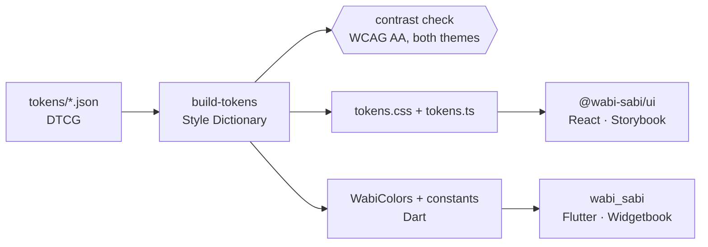

# wabi-sabi

One set of design tokens, two component libraries: **`@wabi-sabi/ui`** for React and
**`wabi_sabi`** for Flutter. Change a colour once and both platforms follow, in light and
dark.

**Live docs:** [Storybook (React)](https://OWNER.github.io/wabi-sabi/storybook/) ·
[Widgetbook (Flutter)](https://OWNER.github.io/wabi-sabi/widgetbook/)

> Status: early. Three components on both platforms. Nothing is published to npm or
> pub.dev yet.

## How it fits together



`tokens/` holds primitives (raw values), component tokens, and one semantic file per theme.
The two semantic files use the same names and point at different primitives.
`pnpm tokens` generates every platform's theme and fails the build if any text or control
misses WCAG AA contrast.

## Context

The project brings together practices I have used on production design systems: tokens
with a theme per application, Storybook, Chromatic, axe in tests, and a versioned package
with a changelog. What it adds is a Flutter layer fed by the same tokens, held to the same
accessibility bar.

## Decisions

- **DTCG JSON** (`$value`, `$type`), the W3C draft format. It is tool-neutral, Style
  Dictionary reads it natively, and it leaves room to sync with Figma later.
- **Three tiers: primitive → semantic → component.** Components never touch a primitive.
  On the web, Stylelint enforces this; in Flutter, components read only `WabiColors`.
- **CSS variables on the web.** No runtime cost. `data-theme` on `<html>` picks the theme,
  and `prefers-color-scheme` applies when nothing is set.
- **`ThemeExtension` in Flutter.** Material 3 `ThemeData` as the base, plus `WabiColors`
  for the semantic tokens, read with `context.wabiColors`.
- **Generated files are committed.** The Flutter CI job needs no Node, and a CI job fails
  if the committed outputs drift from the JSON.

## Where it departs from the spec

| Spec | Here | Why |
| --- | --- | --- |
| `packages/react` | `packages/ui` | The existing package and npm name; renaming it would only add churn. |
| `color.bg.default`, `color.text.muted`… | `--ws-canvas`, `--ws-text-subtle`… | Existing names kept; mapping below. |
| One primitive palette | Primitives per mode | The 12-step scales invert in dark mode. |
| Button `primary/secondary`, `sm/md` | `solid/soft/ghost`, `sm/md/lg` | The existing React API is kept, as the spec asks. |
| 44px touch target | 44px on the web, 48dp in Flutter | Flutter's Android guideline requires 48×48. |
| MDX usage pages | TSX usage pages | MDX tooling needs the TypeScript compiler API, absent in TS 7.0. |
| One `CHANGELOG.md` | An index linking each package's | Changesets and pub each expect their own. |

| Spec concept | Token |
| --- | --- |
| `bg.default` / `bg.subtle` | `canvas` / `base` |
| `text.default` / `text.muted` / `text.on-primary` | `text-default` / `text-subtle` / `on-accent` |
| `border.default` | `line` (decorative), `line-strong` (controls, 3:1) |
| `primary.default` / `.hover` / `.pressed` | `accent` / `accent-hover` / hover + press scale |
| `danger.default` / `success.default` | `danger` / `success` |
| `focus.ring` | `focus` |

## Run it

Requires Node 24, pnpm 11 and Flutter 3.47.

```bash
pnpm install && flutter pub get
pnpm tokens              # generate themes from /tokens, check contrast
pnpm storybook           # React docs on :6006
pnpm test                # React unit tests with axe
pnpm test:storybook      # every story in Chromium, both themes
cd packages/flutter && flutter test                   # widget + accessibility tests
cd packages/flutter_widgetbook && flutter run -d chrome
```

See [CONTRIBUTING.md](CONTRIBUTING.md) to add a component, and [CHANGELOG.md](CHANGELOG.md)
for releases.

## Next steps

- Sync with Figma through Tokens Studio, which reads and writes DTCG.
- Multiple brands: one semantic file per brand and theme, same names.
- More components, starting with the ones whose web API is settled.
- Publish to npm and pub.dev.

## License

MIT
